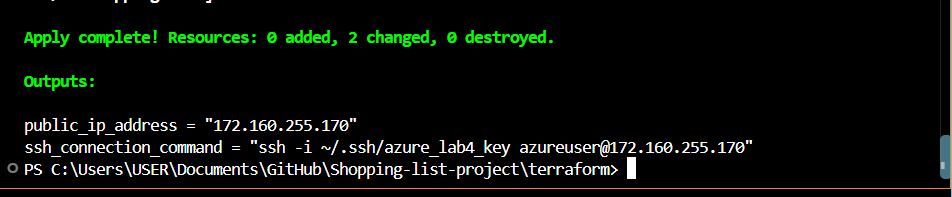
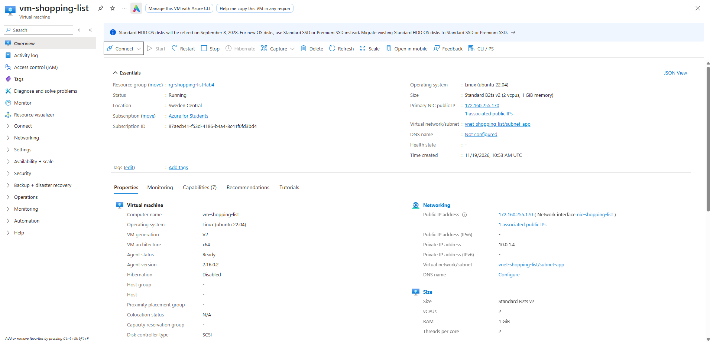
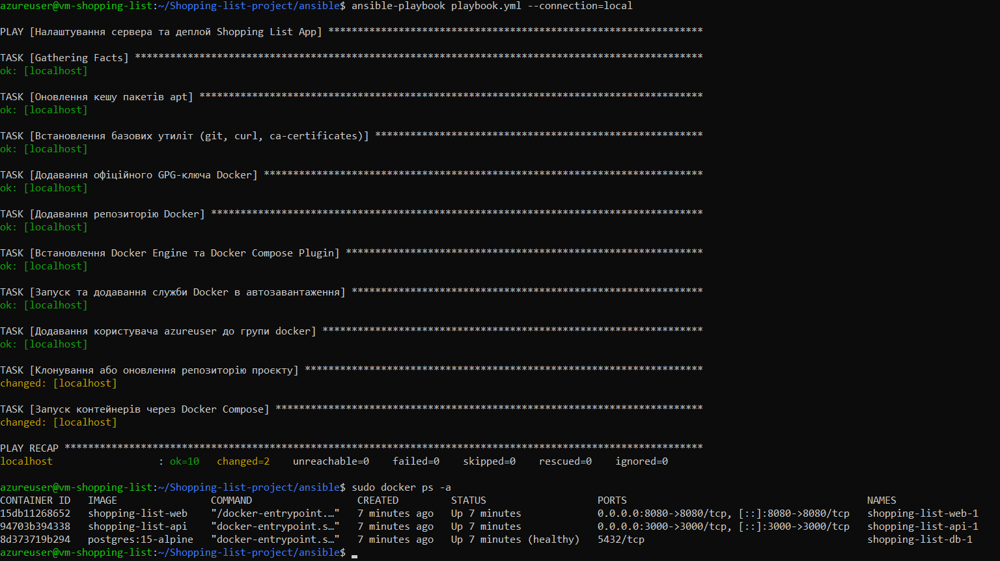
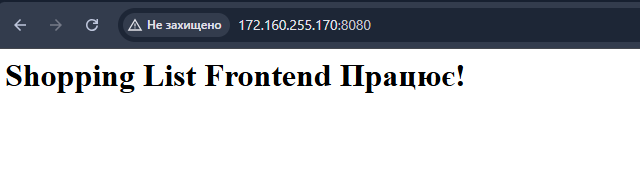

# ADR 004: Автоматизація хмарної інфраструктури (Terraform) та конфігурації (Ansible)

* **Статус:** Прийнято
* **Дата:** 2026-11-19
* **Контекст:** Лабораторна робота №4 (розгортання мультиконтейнерного застосунку Shopping List у хмарному середовищі Microsoft Azure).

## Проблема
Ручне створення віртуальних машин, мережевих екранів та налаштування середовища (встановлення Docker, клонування коду, запуск сервісів) є повільним, схильним до людських помилок і не відтворюваним процесом. Необхідно забезпечити декларативне розгортання інфраструктури та автоматизовану доставку коду.

## Прийняті рішення

1. **Infrastructure as Code (IaC) — Terraform:**
   * Обрано Terraform для опису хмарних ресурсів Azure (`Resource Group`, `VNet`, `Subnet`, `Public IP`, `NSG`, `Linux VM`).
   * **Вибір регіону та розміру ВМ:** Через регіональні квоти студентської підписки *Azure for Students* розгортання перенесено у регіон **Sweden Central** з використанням економічної та продуктивної конфігурації **Standard_B2ts_v2** (Ubuntu 22.04 LTS).
   * **Мережева безпека (NSG):** Окрім SSH (22) та HTTP (80), відкрито порти **8080** (веб-інтерфейс) та **3000** (REST API) відповідно до конфігурації Docker Compose.

2. **Configuration Management — Ansible:**
   * Обрано Ansible для ідемпотентного налаштування сервера (встановлення Docker Engine, Docker Compose, клонування репозиторію в `/opt/shopping-list` та підняття контейнерів).
   * **Локальний режим виконання (`--connection=local`):** Оскільки робоча станція розробника працює під керуванням Windows без повноцінної ОС у WSL, прийнято рішення виконувати плейбук безпосередньо на цільовій ВМ після завантаження актуальної конфігурації з Git. Це спростило роботу з SSH-ключами та усунуло потребу в додатковій проміжній інфраструктурі.

## Наслідки
* **Позитивні:** Повна відтворюваність середовища з нуля за лічені хвилини; прозорий контроль змін мережі та інфраструктури через Git; швидке очищення ресурсів командою `terraform destroy` для збереження балансу підписки.
* **Негативні / Обмеження:** Збереження стану інфраструктури (`terraform.tfstate`) відбувається локально.

## Верифікація та результати впровадження

### 1. Розгортання інфраструктури через Terraform
Успішне створення хмарних ресурсів та отримання публічної IP-адреси:

### 2. Стан віртуальної машини в порталі Azure
Віртуальна машина `vm-shopping-list` запущена у регіоні Sweden Central:

### 3. Автоматизація конфігурації через Ansible
Виконання плейбуку завершилося без помилок (`failed=0`):

### 4. Робота розгорнутого застосунку
Контейнери сервісів активні, веб-інтерфейс доступний у браузері:

