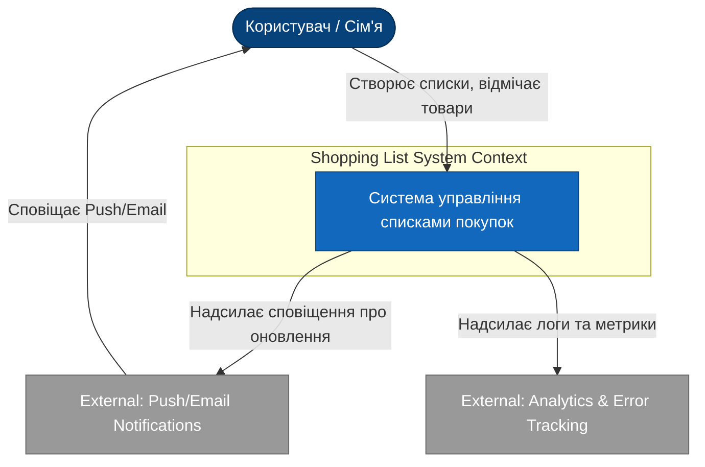
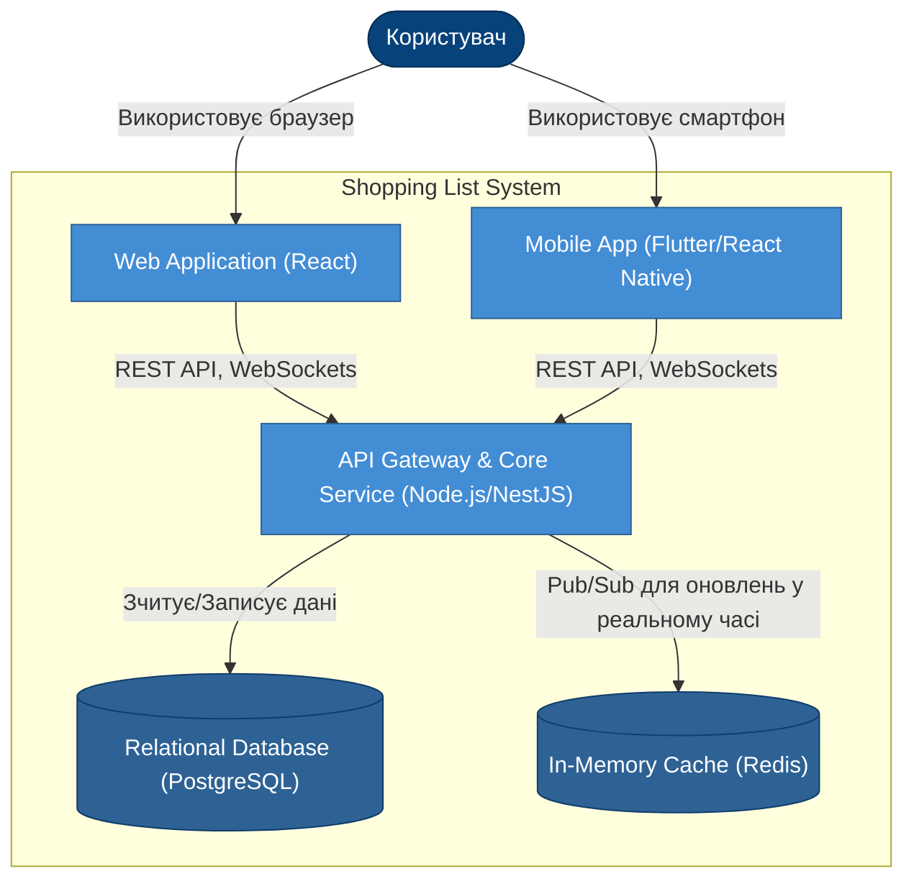
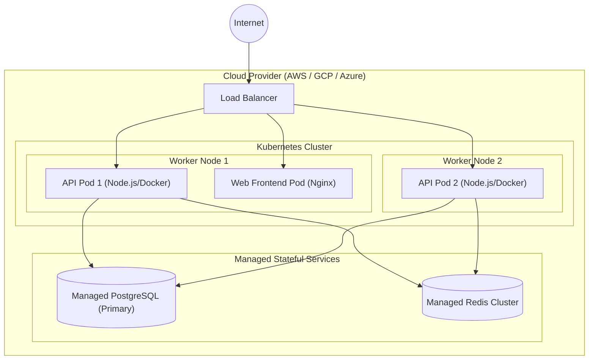

# Архітектура системи (C4 Model та Deployment View)

Цей документ описує архітектуру системи планування покупок з використанням підходу **Architecture as Code**. Діаграми побудовані за допомогою синтаксису Mermaid.js.

## 1. C4 Level 1: System Context

Діаграма відображає взаємодію користувачів із системою та зовнішніми сервісами на найвищому рівні абстракції.

## 2. C4 Level 2: Container Diagram

Діаграма демонструє основні програмні компоненти системи, їхню відповідальність та взаємодію між собою.

## 3. Deployment View: Діаграма розгортання

Діаграма відображає передбачувану інфраструктуру розгортання застосунку у хмарному середовищі з використанням контейнеризації Docker та оркестрації Kubernetes.

